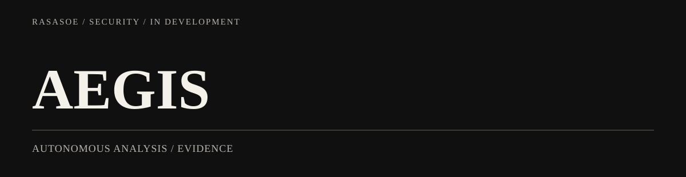
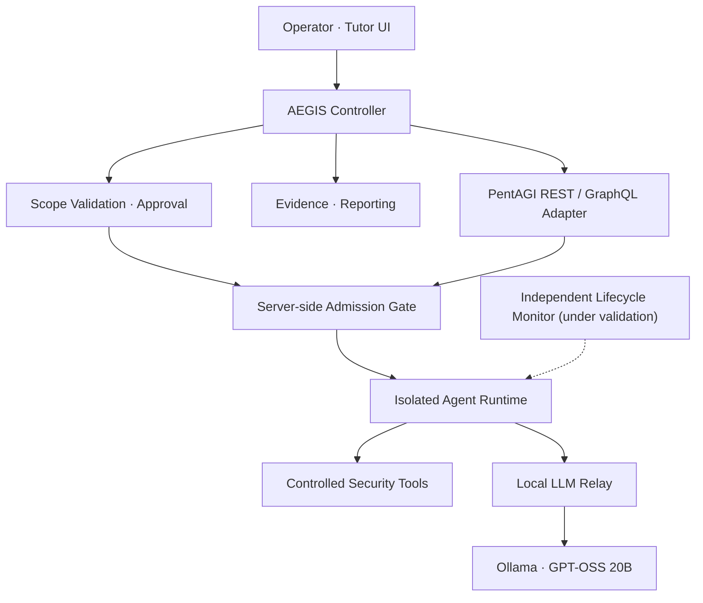

<picture>
  <source media="(max-width: 600px)" srcset="assets/aegis-banner-mobile.svg">
  
</picture>

<a href="README.md">한국어</a> / <strong>English</strong>

# AEGIS — Autonomous Security AI Platform

**In development · Individual engineering project · Local models / Execution approval / Evidence**

Connecting a security agent to tools is only part of the problem. The harder question is **whether execution can be constrained, stopped at the running-task level, and tied to reproducible evidence**.

AEGIS integrates local models, PentAGI and a separate Python Controller around **scope checking → operator approval → isolated tool execution → evidence review**.

[Architecture](docs/ARCHITECTURE.md) · [Roadmap](docs/ROADMAP.md) · [Developer profile](https://github.com/rasasoe)

---

## Timeline and what this project is meant to prove

**Status:** In progress · **documented public development/verification activity:** October 2026–present (not a verified original start date).

The central question is not whether an AI can call a tool, but whether it can be **prevented from acting outside an approved scope**, **stopped at the actual running-task level**, and required to **link conclusions to verifiable tool/HTTP evidence**.

| Validation question | Evidence boundary |
| --- | --- |
| Can unapproved targets and tools be blocked? | Local Controller, approval and scope-guard tests passed |
| Does STOP terminate the live agent task? | Simulated lifecycle-monitor tests passed; live-task termination remains unverified |
| Are security conclusions supported by reproducible evidence? | End-to-end autonomous finding and HTTP evidence tests remain incomplete |

The 305/305 regression tests recorded October 26, 2026 are **local tests**, not a real-world vulnerability discovery rate.

## What is AEGIS?

**AEGIS (Autonomous Security AI Platform)** is a personal software engineering project integrating local language models, an autonomous security-agent engine, and a separate execution-control layer.

The system is designed around **operator approval → scope validation → isolated execution → evidence review**. Giving an AI model access to tools does not itself guarantee that an action is authorized or that a finding is correct.

> **Development status:** The native PentAGI Flow cancellation and task-termination path has not yet been verified. No successful autonomous vulnerability discovery is claimed.

## Engineering Focus

- **Local model and agent orchestration:** Ollama, PentAGI, a Python Controller and API adapters
- **Scope and approval:** Bounded targets, explicit approvals and server-side admission checks
- **Isolated execution:** QEMU/Docker boundaries and lifecycle monitoring; live termination validation remains open
- **Evidence and reporting:** Separate tool observations from model interpretations

## Conceptual Architecture

This is a **conceptual responsibility map**, not a claim that every path has passed native end-to-end tests. [Architecture and ownership details](docs/ARCHITECTURE.md)

## Current Verification

| Component | Last recorded result |
| --- | --- |
| Python Controller, Scope Guard, approval flow | Implemented and locally tested |
| Windows Ollama → relay → PentAGI | **Actual GPT-OSS 20B model response verified** |
| PentAGI official mock tool calls | **9/9 passed** |
| Automated regression tests | **305/305 passed** |
| Independent server-side lifecycle monitor | Implemented; synthetic integration tests passed |
| Native PentAGI Flow cancellation / task disappearance | **Pending verification; execution blocked** |
| Evidence-backed autonomous vulnerability discovery | **Not attempted** |

**Evidence checkpoint: October 26, 2026.** Automated test counts are not penetration-testing success metrics.

## Technology Stack

## Project Work vs. Upstream Dependencies

| Area | Role |
| --- | --- |
| AEGIS engineering | Controller/adapter integration, scope validation, approvals, execution admission, lifecycle monitoring, evidence and tutor integration |
| [PentAGI](https://github.com/vxcontrol/pentagi) | Upstream open-source autonomous security-agent engine |
| [Ollama](https://github.com/ollama/ollama) | Local model server |
| Semgrep, Bandit, Docker, QEMU | External analysis and runtime tooling |

**AEGIS does not claim authorship of PentAGI.** The public documentation distinguishes the upstream engine from project-specific integration and controls.

## Next Milestones

1. Verify native STOP and deadline-based cancellation through no-target echo/sleep flows.
2. Conduct one explicitly authorized, tightly scoped OWASP Juice Shop lab evaluation.
3. Publish a sanitized demonstration and reproducible HTTP evidence if obtained.
4. Advance the Korean-language security tutor and integrated analysis UI.

[Development roadmap](docs/ROADMAP.md)

## Publication Policy

This repository is a **public portfolio and project status page**, not a ready-to-run security product.

- **Public:** goals, high-level architecture, verified milestones, future sanitized demonstrations.
- **Private:** active source code, credentials, internal endpoints/network topology, environment configuration, sensitive logs.
- **Testing boundary:** only explicitly authorized and isolated local lab targets.

---

  AEGIS · Autonomous Security AI Platform · In Development

