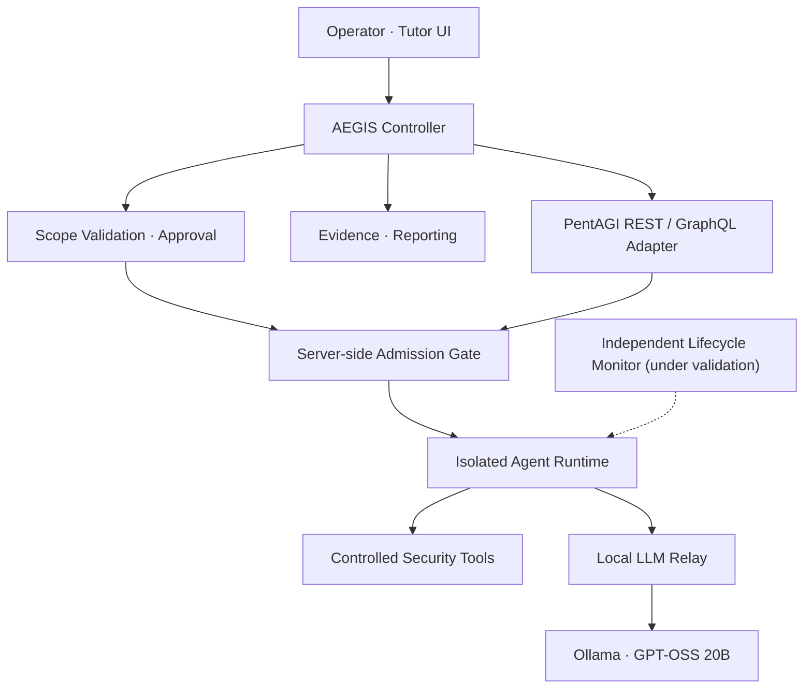

  
  
<strong>Local AI · Autonomous Agents · Controlled Execution · Verifiable Evidence</strong>

  

    
    
    
    
  

  
<a href="README.md">🇰🇷 한국어</a> · <strong>🇺🇸 English</strong>

  
<a href="docs/ARCHITECTURE.md">Architecture</a> · <a href="docs/ROADMAP.md">Roadmap</a> · <a href="https://github.com/rasasoe">Developer Profile</a>

---

## What is AEGIS?

**AEGIS (Autonomous Security AI Platform)** is a personal software engineering project integrating local language models, an autonomous security-agent engine, and a separate execution-control layer.

The system is designed around **operator approval → scope validation → isolated execution → evidence review**. Giving an AI model access to tools does not itself guarantee that an action is authorized or that a finding is correct.

> **Development status:** The native PentAGI Flow cancellation and task-termination path has not yet been verified. No successful autonomous vulnerability discovery is claimed.

## Engineering Focus

<table>
<tr><td width="50%" valign="top"><strong>🧠 Local AI + Agent Orchestration</strong> An Ollama-hosted GPT-OSS 20B model, PentAGI, a Python controller, and REST/GraphQL adapters.</td><td width="50%" valign="top"><strong>🛡️ Scope & Approval</strong> Explicitly bounded targets, short-lived one-time approvals, and server-side checks against unapproved execution.</td></tr>
<tr><td valign="top"><strong>🔒 Isolated Execution</strong> QEMU/Docker-based separation, bounded HTTP requests, and an independent STOP boundary.</td><td valign="top"><strong>🔍 Evidence & Security Tutor</strong> Distinguishing tool observations from model claims, with evidence checks, reporting, and Korean-language learning support.</td></tr>
</table>

## Conceptual Architecture

This is a **conceptual responsibility map**, not a claim that every path has passed native end-to-end tests. [Architecture and ownership details](docs/ARCHITECTURE.md)

## Current Verification

| Component | Last recorded result |
| --- | --- |
| Python Controller, Scope Guard, approval flow | Implemented and locally tested |
| Windows Ollama → relay → PentAGI | **Actual GPT-OSS 20B model response verified** |
| PentAGI official mock tool calls | **9/9 passed** |
| Automated regression tests | **305/305 passed** |
| Independent server-side lifecycle monitor | Implemented; synthetic integration tests passed |
| Native PentAGI Flow cancellation / task disappearance | **Pending verification; execution blocked** |
| Evidence-backed autonomous vulnerability discovery | **Not attempted** |

**Evidence checkpoint: October 26, 2026.** Automated test counts are not penetration-testing success metrics.

## Technology Stack

## Project Work vs. Upstream Dependencies

| Area | Role |
| --- | --- |
| AEGIS engineering | Controller/adapter integration, scope validation, approvals, execution admission, lifecycle monitoring, evidence and tutor integration |
| [PentAGI](https://github.com/vxcontrol/pentagi) | Upstream open-source autonomous security-agent engine |
| [Ollama](https://github.com/ollama/ollama) | Local model server |
| Semgrep, Bandit, Docker, QEMU | External analysis and runtime tooling |

**AEGIS does not claim authorship of PentAGI.** The public documentation distinguishes the upstream engine from project-specific integration and controls.

## Next Milestones

1. Verify native STOP and deadline-based cancellation through no-target echo/sleep flows.
2. Conduct one explicitly authorized, tightly scoped OWASP Juice Shop lab evaluation.
3. Publish a sanitized demonstration and reproducible HTTP evidence if obtained.
4. Advance the Korean-language security tutor and integrated analysis UI.

[Development roadmap](docs/ROADMAP.md)

## Publication Policy

This repository is a **public portfolio and project status page**, not a ready-to-run security product.

- **Public:** goals, high-level architecture, verified milestones, future sanitized demonstrations.
- **Private:** active source code, credentials, internal endpoints/network topology, environment configuration, sensitive logs.
- **Testing boundary:** only explicitly authorized and isolated local lab targets.

---

  AEGIS · Autonomous Security AI Platform · In Development

