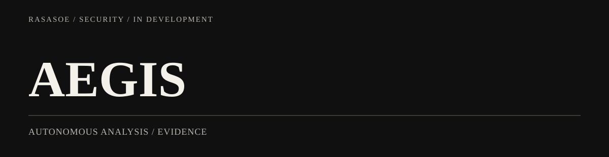
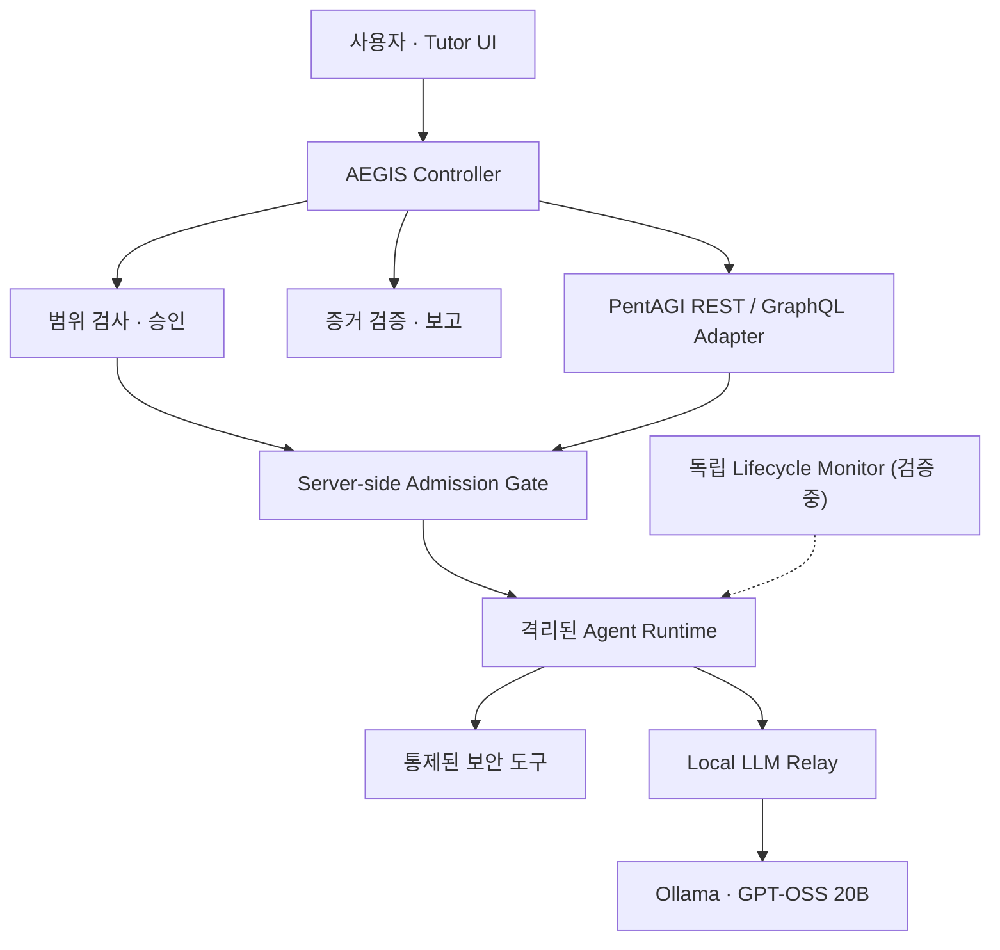

<picture>
  <source media="(max-width: 600px)" srcset="assets/aegis-banner-mobile.svg">
  
</picture>

<strong>한국어</strong> / <a href="README.en.md">English</a>

# AEGIS — Autonomous Security AI Platform

**진행 중 · 개인 개발 · 로컬 AI / 보안 에이전트 / 실행 승인 / 증거 추적**

AI가 보안 도구를 호출할 수 있게 만드는 것보다 어려운 문제는 **AI가 권한 밖 작업을 실행하지 못하게 막고, 실제 중단되며, 결과를 검증 가능한 증거로 남기는 것**입니다.

AEGIS는 로컬 모델·PentAGI·Python Controller를 결합해 **범위 검사 → 사용자 승인 → 격리 실행 → 증거 검토**를 통제하는 시스템을 개발하고 있습니다.

[시스템 설계](docs/ARCHITECTURE.md) · [개발 로드맵](docs/ROADMAP.md) · [개발자 프로필](https://github.com/rasasoe)

---

## 개발 기간과 검증 질문

**상태:** 진행 중 · **확인된 공개 개발·검증 기록:** 2026.10–현재 (최초 개발 착수일과는 구분)

기존 보안 도구에 AI를 붙이는 데서 그치지 않고, **AI 에이전트의 판단이 실제 도구 실행으로 이어질 때 승인과 범위를 강제할 수 있는지**를 검증하려는 프로젝트입니다.

| 검증 질문 | 확인된 범위 |
| --- | --- |
| 승인 없이 범위 밖 도구가 실행되는가? | Controller·승인·Scope Guard의 로컬 테스트 완료 |
| 중단 시 실행 중인 작업이 실제로 종료되는가? | 감시기 모의 통합 테스트까지 수행, 실제 실행 작업 종료 보장 미검증 |
| AI의 보안 판단이 도구·HTTP 증거로 뒷받침되는가? | 실제 자율 취약점 발견·증거 수집 종단 간 검증 미완료 |

**증거 기준:** 2026-10-26 회귀 테스트 305/305 통과는 로컬 코드 검증이며, 실환경 자율 분석 성능이나 제품 완성도를 뜻하지 않습니다.

## AEGIS는 무엇인가?

**AEGIS(Autonomous Security AI Platform)**는 로컬 LLM과 자율 보안 에이전트를 결합하고, AI의 판단과 실제 도구 실행 권한을 분리하는 개인 개발 프로젝트입니다.

AI가 도구를 사용할 수 있다는 사실만으로 분석이 안전하거나 결과가 정확하다는 뜻은 아닙니다. AEGIS는 **사용자 승인 → 실행 범위 검증 → 격리된 도구 실행 → 증거 확인**의 흐름을 중심으로 개발되고 있습니다.

> **현재 상태: 개발 중.** 실제 PentAGI Flow의 네이티브 종료 검증이 완료되지 않았으며, 최초 자율 취약점 발견 실험도 아직 수행하지 않았습니다.

## 핵심 설계

- **로컬 AI·에이전트 연결:** Ollama, PentAGI, Python Controller 및 API 어댑터
- **범위·승인 통제:** 허용된 대상과 일회성 승인, 무승인 요청의 서버 측 차단
- **격리 및 종료:** QEMU/Docker 실행 경계와 감시기(실제 종료 보장 검증 중)
- **증거·보고:** 도구 결과와 LLM 추론을 구분해 검증 가능한 결과로 남기는 구조

## 아키텍처 개요

이 그림은 **논리적 책임 구조**를 나타냅니다. 모든 경로가 실제 환경에서 종단 간 검증됐다는 의미는 아닙니다. [설계 및 구현 범위](docs/ARCHITECTURE.md)

## 개발 및 검증 현황

| 검증 항목 | 최신 기록 기준 |
| --- | --- |
| Python Controller / Scope Guard / 승인 절차 | 구현 · 로컬 테스트 통과 |
| Windows Ollama → 릴레이 → PentAGI | **실제 GPT-OSS 20B 응답 확인** |
| PentAGI 공식 모의 도구 호출 | **9/9 통과** |
| 전체 자동 회귀 테스트 | **305/305 통과** |
| 독립 서버 측 종료 감시기 | 구현 · 모의 통합 테스트 통과 |
| 실제 PentAGI Flow 종료·작업 소멸 | **미검증 · 실행 차단 유지** |
| 실제 취약점 자율 발견 및 HTTP 증거 | **미실시** |

**검증 기록 기준일: 2026-10-26.** 테스트 통과 수는 코드와 모의 환경의 검증 수치이며, 실제 침투 테스트 성공률이나 실서비스 보안 성능 수치가 아닙니다.

## 기술 스택

## AEGIS에서 직접 다루는 부분

| 구분 | 역할 |
| --- | --- |
| AEGIS 프로젝트 | Controller/Adapter 통합, 범위 검증·승인, 실행 차단, 감시기 개발, 증거·보고·Tutor 통합 |
| [PentAGI](https://github.com/vxcontrol/pentagi) | 외부 오픈소스 자율 보안 에이전트 엔진 |
| [Ollama](https://github.com/ollama/ollama) | 로컬 모델 서빙 |
| Semgrep · Bandit · Docker · QEMU | 외부 분석·격리 도구 |

**PentAGI를 자체 개발한 것처럼 표기하지 않습니다.** 외부 엔진 위에 구축한 AEGIS 고유의 제어·검증·사용자 인터페이스 작업을 구분합니다.

## 다음 마일스톤

1. 실제 무대상 echo/sleep Flow로 STOP 및 독립 타임아웃 종료 검증
2. 승인된 로컬 OWASP Juice Shop 첫 제한적 자율 분석
3. 재현 가능한 HTTP 증거와 익명화된 데모 공개
4. 한국어 보안 Tutor와 분석 결과 UI 통합 고도화

상세 진행 상태: [Roadmap](docs/ROADMAP.md)

## 공개 정책

이 저장소는 **포트폴리오 및 개발 현황 공개용**입니다. 실행 가능한 전체 제품 배포본이 아닙니다.

- **공개:** 목적, 고수준 설계, 검증된 테스트 결과, 향후 익명화된 데모
- **비공개:** 개발 중인 실제 소스, 인증 정보, 내부 주소·네트워크 구성, 환경 설정, 민감한 실행 로그
- **실습 원칙:** 명시적으로 승인받은 격리된 로컬 환경에서만 검증

---

  AEGIS · Autonomous Security AI Platform · In Development

