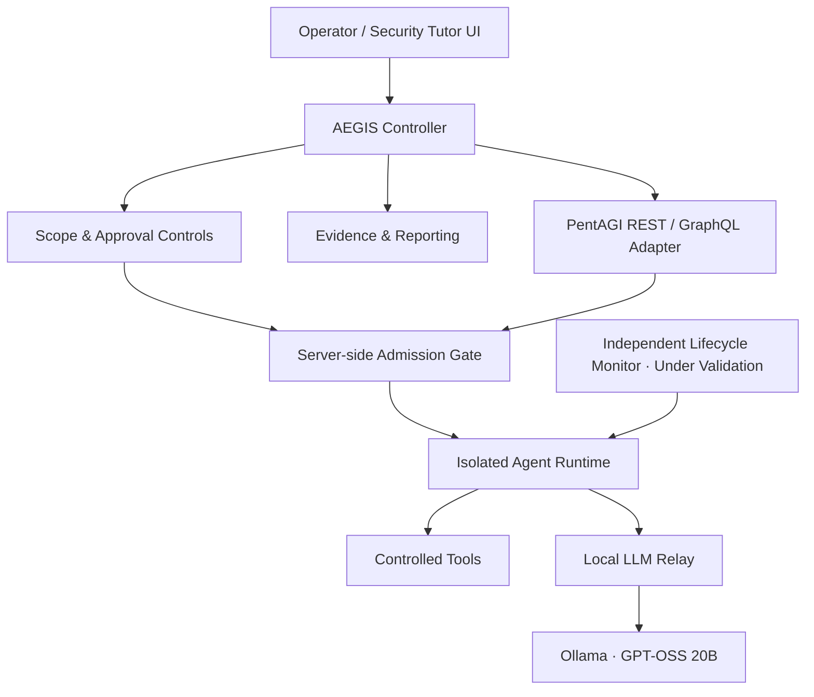

# AEGIS

**Autonomous Security AI Platform** · **In Development**

> Building a local-first cybersecurity AI system that connects autonomous security agents with scoped execution, human approval, and evidence-based reporting.

**AEGIS는 로컬 LLM과 자율 보안 에이전트를 통합해, 분석 과정의 통제 가능성과 결과의 검증 가능성을 높이기 위한 개인 개발 프로젝트입니다.** 현재는 구현과 통합 검증을 진행하고 있으며, 실제 취약점 자율 발견을 완료한 제품으로 소개하지 않습니다.

**Project status:** Active development · October 2026  
**Source availability:** Private development repository; public documentation only

---

## Why AEGIS?

Autonomous agents can plan and invoke security tools, but an agent's proposed action is not the same as an authorized action. AEGIS focuses on separating the **AI reasoning layer** from the **execution authority**, collecting verifiable evidence, and making the process understandable to a human operator.

### Key engineering areas

| Area | Approach |
| --- | --- |
| Agent integration | Python controller with REST/GraphQL adapters for the upstream PentAGI engine |
| Local inference | Windows Ollama, GPT-OSS 20B, and a local model relay |
| Scope and approval | Explicit target constraints, time-limited one-time approval, server-side admission checks |
| Execution isolation | Separate QEMU/Docker-based execution boundary and an independently enforced request guard |
| Lifecycle safety | Persistent execution state and independent monitor; **native termination verification is pending** |
| Evidence and learning | Structured findings, integrity checks, security reports, and Korean-language tutoring |
| Development validation | Automated regression, API compatibility, simulated execution-lifecycle tests |

## Architecture

*Conceptual diagram, not a deployable network topology. Some lifecycle paths are still undergoing native integration verification.*

For engineering details and component boundaries, see [Architecture](docs/ARCHITECTURE.md).

## Implementation and verification

| Component / milestone | Current evidence |
| --- | --- |
| Python controller, scope/approval flow, evidence pipeline | Implemented; local unit/integration checks |
| Ollama → relay → PentAGI | Actual local model response verified |
| PentAGI official mock tool calls | **9/9 passed** |
| Local automated regression suite | **305/305 passed** at the last recorded checkpoint |
| Independent server-side lifecycle monitor | Implemented; synthetic integration tests passed |
| Native PentAGI Flow cancellation and worker termination | **Not yet verified end to end** |
| First autonomous vulnerability finding with HTTP evidence | **Not yet performed** |

> **Verification boundary:** Passing regression tests, a successful model response, and mock tool calls do **not** establish that an autonomous penetration test has succeeded. Until native termination has been verified, actual lab runs remain blocked by the project execution policy.

Latest recorded development checkpoint: **2026-10-26**. See [Development roadmap](docs/ROADMAP.md) for the next milestones.

## Technology stack

`Python` · `Ollama` · `GPT-OSS 20B` · `PentAGI` · `Docker` · `QEMU` · `Linux / WSL2` · `SQLite` · `REST` · `GraphQL` · `Semgrep` · `Bandit`

## Original contributions & upstream components

AEGIS is **not** a rebranding of PentAGI.

- **AEGIS project work:** Controller and adapter integration, scope and approval controls, admission-gate integration, execution-guard validation, lifecycle-monitor development, evidence-oriented reporting, and security learning UI.
- **Third-party component:** [PentAGI by VXControl](https://github.com/vxcontrol/pentagi) provides the upstream autonomous security-agent engine; [Ollama](https://github.com/ollama/ollama) serves local models.
- **Other tooling:** Semgrep, Bandit, Docker, QEMU, and associated open-source components are used under their respective licenses.

This distinction is intentional: project integration, testing, engineering decisions, and original modules are described separately from upstream capabilities.

## Planned milestones

1. Verify native PentAGI Flow cancellation, timeout behavior, and cleanup without contacting any analysis target.
2. Complete one tightly scoped, explicitly authorized OWASP Juice Shop lab evaluation using a local model.
3. Publish a sanitized demonstration, reproducible methodology, and findings **only after they are verified**.
4. Expand the Korean security tutor and evidence-based analysis workflows.

## Public disclosure policy

This repository is a **portfolio/showcase**, not the complete application source or a ready-to-run pentesting distribution.

**Public:** project goals, architecture overview, verified checkpoints, non-sensitive demonstrations, selected reports.  
**Private:** application source, infrastructure-specific settings, credentials, tokens, full internal logs, sensitive network details, and unrestricted execution interfaces.

No credentials, secrets, real customer targets, or unapproved network activity are included or endorsed here.

---

**Project:** AEGIS · **Status:** In Development · **Maintainer:** [rasasoe](https://github.com/rasasoe)
