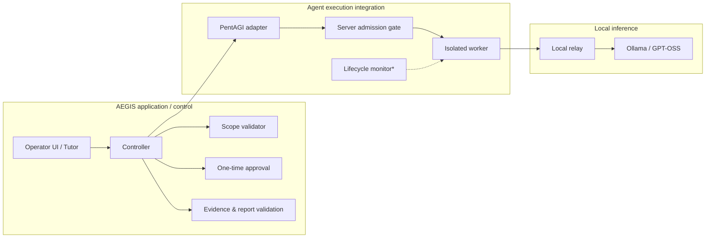

# AEGIS — Architecture & Engineering Scope

> Public, conceptual architecture documentation. **In Development** — no production-grade autonomous security capability is claimed.

## Design goal

AEGIS keeps the decision to investigate separate from the authority to execute. An LLM may propose a plan, but only the validated controller, admission controls, and guarded worker can turn approved intent into an action.

## High-level component boundaries

*** Native lifecycle verification remains incomplete.** This diagram communicates intended responsibility boundaries, not a guarantee that each end-to-end path is ready for unrestricted use.

## Engineering decisions

### 1. Controlled invocation

The operator approves a particular target and bounded plan. The controller associates a short-lived approval with the exact authorized scope. The admission gate is intended to prevent a direct agent/API action from bypassing this approval path.

### 2. Independent request restrictions

The execution worker has a separate request boundary designed to reject traffic outside the approved target and the approved method/request budget. This control is not dependent on the LLM following instructions.

### 3. Lifecycle supervision

A persistent lifecycle record and an independent monitor are implemented and tested against synthetic failure and termination scenarios. Native integration verification — including actual PentAGI Flow cancellation and confirming the underlying work is gone — is still pending. The project retains its **fail-closed** state until this is resolved.

### 4. Evidence integrity

Tool observations, model-generated claims, and verified findings are intentionally distinguished. Analysis results are not labeled verified merely because an LLM asserts them.

### 5. User-facing learning

The Korean tutor and reporting layers are designed to explain security observations and their evidence, not to grant arbitrary execution privileges.

## Implementation ownership and upstream work

| Area | Relationship |
| --- | --- |
| AEGIS controller, scope controls, approvals, evidence/report integration | Project-specific engineering |
| PentAGI agent engine and native agent execution | [VXControl PentAGI](https://github.com/vxcontrol/pentagi), upstream |
| Local model serving | [Ollama](https://github.com/ollama/ollama), upstream |
| Isolated runtimes | QEMU / Docker ecosystem |
| Static analyzers | Semgrep and Bandit, external tools |

## Release and safety note

This documentation intentionally omits operational network details, internal endpoint addresses, credential handling, and instructions for unrestricted agent execution. A public source-code release has **not** been made.
